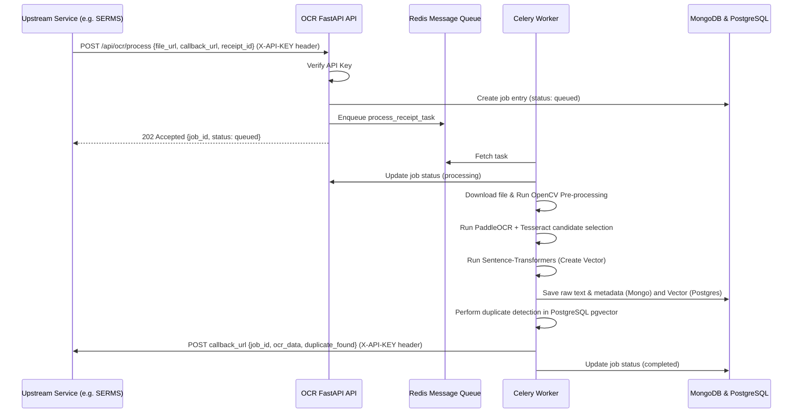

# System Design Document (SDD): OCR Pipeline

## 1. System Components & Subsystems
The OCR Pipeline is structured into three primary subsystems that handle requests, manage background workers, and store data asynchronously.

```
+--------------------------------------------------------+
|                      OCR Pipeline                      |
+------------------+------------------+------------------+
|   1. API Layer   |   2. Task Queue  |  3. Data Layer   |
|     FastAPI      |   Celery Workers | MongoDB/Postgres |
+------------------+------------------+------------------+
```

### 1.1. API Gateway / Router Layer (FastAPI)
Acts as the entry point for all service-to-service communication. Exposes endpoints for scheduling OCR jobs, checking duplicate status, and tracking long-running tasks.
- **`/api/ocr/process` (POST):** Receives file URLs and webhook callback metadata; validates the request, generates a `job_id`, updates MongoDB status to `queued`, and dispatches a Celery task.
- **`/api/duplicate-check` (POST):** Synchronously accepts text or metadata to check for duplicates in the pgvector database.
- **`/api/jobs/{job_id}/status` (GET):** Reads MongoDB to check current job processing state (`queued`, `processing`, `completed`, `failed`).
- **`/health` (GET):** Checks availability of Redis, PostgreSQL, and MongoDB.
- **`/metrics` (GET):** Exposes Prometheus/Application-level metrics.

### 1.2. Asynchronous Processing Worker Layer (Celery)
Consists of dedicated background workers running Celery to isolate heavy CPU/Memory operations.
- **`process_receipt_task`:** 
  1. Retrieves receipt bytes from Redis ephemeral byte cache (`ocr:file_bytes:<sha256>`), falling back to network download (S3/Supabase) on cache miss. Checks 90-day SHA-256 result cache (`ocr:file_hash:<sha256>`); if hit, bypasses OCR extraction and immediately executes vector embedding, duplicate detection, persistence, and webhook callback.
  2. Applies OpenCV filters (e.g., adaptive thresholding, deskewing).
  3. **Fast path (early exit):** runs a single cheap Tesseract pass over the preprocessed image (`read_fast`, PSM 6). If the reading's receipt-aware anchor score clears `FAST_PATH_ANCHOR_SCORE` (6.0), extraction runs against this single pass; when the money reconciles AND a total is present (`fast_path_sufficient`), the receipt ships immediately — skipping the multi-pass pool entirely. When the first pass scores below the threshold, a second cheap pass (`read_fast_fallback`) over the `flat` rendering at PSM 11 gets one more try before the pool, rescuing clean receipts whose best-effort rendering degrades (e.g. deskew/denoise hurting that particular image). Otherwise the worker **escalates**: PaddleOCR and the full Tesseract variant × PSM pool run concurrently, selecting the strongest reading by anchor scoring while retaining all candidates for amount/item reconciliation; failed engines degrade independently. PaddleOCR receives the orientation-corrected image (`correct_orientation`), ensuring sideways (90°/270°) captures are read upright. Tall/narrow receipts (aspect ≥ 2.0, e.g. long grocery POS slips) get `text_det_limit_side_len=512` in `read_paddle` — measured ~30% faster with identical line/character output (the default 960px limit blows the internal image up to ~3820px). Supporting readings scoring below `primary.score / 2.0` are dropped from `combined_text` so Tesseract garbage never pollutes the LLM prompt. Item parsing handles price-first grocery layouts (`64.00 V` / `1 × 64.00` / barcode + store code) via a pending-item mechanism, and store-code names (uppercase + mixed alphanumeric tokens like `EP025G`) are kept verbatim — exempt from dictionary and LLM normalization.
  4. Generates a 384-dimensional semantic embedding via `sentence-transformers` (`all-MiniLM-L6-v2`) — computed **once** per job and reused for both duplicate detection and pgvector storage.
  5. Stores raw text, confidence, and metadata in MongoDB.
  6. Inserts the embedding vector into PostgreSQL.
  7. Performs a duplicate lookup via pgvector.
  8. Triggers the callback webhook to post results back to the caller.

### 1.3. Persistence & Cache Layer
- **Redis:** Message broker for Celery, ephemeral byte handoff cache (`ocr:file_bytes:<url_sha256>`, TTL 10m) between API validation and Celery worker execution, and 90-day SHA-256 result cache (`ocr:file_hash:<content_sha256>`).
- **MongoDB:** Flexible metadata storage. No relational constraints, allowing arbitrary line items, confidence scores, and raw OCR outputs to be stored as a single document.
- **PostgreSQL (with pgvector):** Primary relational engine storing document embeddings and executing cosine similarity queries.

---

## 2. Data Flow & Integration Points

### 2.1. Ingestion & Processing Data Flow
The sequence diagram below represents the end-to-end lifecycle of a receipt upload and OCR processing workflow:



### 2.2. Authentication & Security
- **Service-to-Service Authentication:** All REST API endpoints require a pre-shared API Key passed in the `X-API-KEY` HTTP header. 
- **Webhook Security:** Outbound webhook callbacks sent from the Celery workers to the upstream caller also attach the `X-API-KEY` header to authenticate the payload on the receiver's end.
- **CORS Settings:** No CORS configuration is exposed or permitted because this service is solely accessed backend-to-backend. No browser clients communicate directly with the OCR Pipeline.

---

## 3. Configuration & Environment
The microservice is configured using environment variables loaded at runtime via Pydantic Settings.

| Variable | Type | Default | Description |
|---|---|---|---|
| `APP_NAME` | string | `ocr-pipeline` | Name of the service. |
| `APP_ENV` | string | `development` | Service runtime environment (`development`, `production`). |
| `APP_PORT` | integer | `8010` | Port FastAPI listens on inside the container. |
| `SERMS_API_KEY` | string | — | Pre-shared key for authenticating incoming API requests. |
| `CALLBACK_API_KEY` | string | — | API key attached to outgoing webhook callbacks. |
| `OLLAMA_BASE_URL` | URL string | `http://ocr_ollama:11434` | Base connection URL for Ollama local LLM processing. |
| `REDIS_URL` | URL string | `redis://ocr_redis:6379/0` | URL for Celery message broker. |
| `MONGODB_URL` | URL string | `mongodb://ocr_mongo:27017` | Database connection string for MongoDB. |
| `POSTGRES_URL` | URL string | — | Async pgvector database connection string. |
| `EMBEDDING_MODEL` | string | `all-MiniLM-L6-v2` | Model name used for text embedding. |
| `DUPLICATE_SIMILARITY_THRESHOLD` | float | `0.85` | Cosine similarity cutoff for flagging duplicates. |
| `DUPLICATE_DAYS_WINDOW` | integer | `90` | Timeframe in days to look back for duplicate receipts. |
| `OMP_NUM_THREADS` / `OMP_THREAD_LIMIT` | integer | `1` | Container-level OpenMP caps for worker Tesseract fallback processes. |
| `OLLAMA_KEEP_ALIVE` | string | `-1` | How long the Ollama model stays resident after a call (`-1` = indefinite, preventing cold KV cache reloads). |
| `OLLAMA_NUM_CTX` | integer | `2048` | Explicit context window sent with each generation request (keeps `qwen3:1.7b` resident RAM ~1.55 GB within a 2 GB limit). |
| `OLLAMA_ASSIST_TIMEOUT` | float | `20.0` | Timeout in seconds for Ollama assist calls to prevent worker thread starvation. |
| `ENABLE_LLM_ITEM_NORMALIZATION` | boolean | `false` | Whether to invoke Ollama for line-item noise normalization (disabled by default; regex/Levenshtein handles normalization deterministically). |
| `FILE_CACHE_BYTE_TTL` | integer | `600` | TTL in seconds for ephemeral image byte handoff between FastAPI and Celery worker (10 minutes). |
| `FILE_CACHE_RESULT_TTL` | integer | `7776000` | TTL in seconds for identical receipt SHA-256 result cache (90 days). |
| `RATE_LIMIT_ENABLED` | boolean | `true` | Enable/disable API rate limiting middleware. |
| `RATE_LIMIT_WINDOW_SECONDS` | integer | `60` | Duration of the sliding fixed-window bucket in seconds. |
| `RATE_LIMIT_OCR_PER_MINUTE` | integer | `30` | Per-service limit for `POST /api/ocr/process`. |
| `RATE_LIMIT_DUPLICATE_PER_MINUTE` | integer | `60` | Per-service limit for `POST /api/duplicate-check`. |
| `RATE_LIMIT_READ_PER_MINUTE` | integer | `120` | Per-service limit for `/api/jobs/*` and `/api/metrics`. |
| `RATE_LIMIT_HEALTH_PER_MINUTE` | integer | `60` | Per-IP limit for `/api/health` and `/`. |
| `RATE_LIMIT_AUTH_FAIL_PER_MINUTE` | integer | `15` | Per-IP limit for failed/unauthenticated attempts on protected endpoints before HTTP 429. |
| `IMAGE_QUALITY_MAX_SEGMENTS` | integer | `6` | Maximum number of image segments accepted for multi-part long receipt processing. |
| `OCR_MAX_ITEMS` | integer | `250` | Maximum number of line items extracted per receipt (handles tall/grocery receipts without truncation). |
| `OCR_VIRTUAL_TILING` | boolean | `true` | Automatically tile single tall receipts (`height >= 1800` & `aspect >= 2.8`) into overlapping strips before OCR to preserve text sharpness. |

Colocated with the warm-model settings, the provider bounds what it feeds the model: only the receipt header (~3500 chars) plus a fixed totals tail (~2500 chars) are sent for selection/semantics/subtotal calls (`_bound_context`), dropping the long itemized middle that would otherwise tax CPU prefill with noise. Vendor/location names live in the header and totals/tax wording in the footer, so bounding preserves the regions the model actually answers from.

## 2.3 Financial semantics stage
After deterministic baseline extraction, the worker conditionally asks the configured Ollama model (`qwen3:1.7b`, non-thinking JSON mode) for **one consolidated structured response** covering vendor choice, location, tax/currency semantics, and subtotal verification — a single bounded generation replaces up to four separate calls (on CPU-only Ollama each generation costs tens of seconds and concurrent calls serialize on the model queue). The prompt permits only tax basis, confidence/evidence, currency, closed-list vendor/location picks, and a subtotal; it cannot invent amounts outside the offered lists. Every field is validated by the caller against its closed list before use, so a wrong answer stays bounded and a hallucinated one is rejected exactly as before.

Responses are accepted only at confidence >= 0.75 with evidence grounded in OCR and otherwise fail soft. The fast path deliberately skips the model (dictionary-only normalization, `use_llm=False`): when a single pass reconciles the receipt it does so without paying the LLM round trip.

Deterministic receipt wording and grounded arithmetic outrank the model. Caller context outranks receipt/OCR context; country is only a fallback prior. The final deterministic extraction is rerun with accepted semantics before verification and reconciliation. Exclusive receipts may use an independently grounded net/subtotal plus tax to compute a callback total; unknown basis never authorizes that substitution.

Tax-basis fallbacks are per-country so Malaysian receipts stay deterministic offline: `MY` receipts carrying `SST`/`GST` wording are treated as exclusive (tax added on top of the subtotal), which lets `total_sales = net + tax` derive even when the model assist is unavailable. Currency detection ignores the `Sdn. Bhd.` company suffix (a common Malaysian register suffix) so it is never misread as the `BHD` currency code. Invoice-number lookup accepts semicolon and comma separators in addition to `:`, `.`, and `#`, because fast-path single-pass OCR frequently transcribes `Invoice number; 12345` and `No, 38326`.

## 2.4 Multi-Segment & Long Receipt Pipeline
Long thermal receipts (e.g., supermarket runs with 20–100+ items) frequently present either as multiple overlapping uploaded photos (`file_urls`) or a single high-aspect-ratio panorama. Processing them through monolithic image stitching or single-pass detector resize causes acute issues: duplicated seam items, detector downscaling blur, and Tesseract thread thrashing on anchorless middle segments.

The long-receipt pipeline addresses this via:
1. **Parallel Ingestion & 3-Zone Quality Check:** All segments download concurrently via `asyncio.gather`. Tall images (`height >= 2.0 * width`) undergo 3-zone Laplacian variance checks (top, middle, bottom) so localized camera defocus or motion blur is caught before OCR.
2. **Segment Density Scoring & Auto-Ordering:** Each segment is scored for `header_score`, `body_score`, and `footer_score` based on tax anchors (`TIN`, `Date`, `Invoice`), item density (`x`, `@`, decimal prices), and payment summaries (`Subtotal`, `Cash`, `Change`). Segments are ordered topologically `(header -> body segments -> footer)` with seam text chaining, falling back to caller order if ambiguous.
3. **Density-Aware Fast-Path:** Middle segments typically contain dense item rows with zero header anchors. Standard fast-path anchor requirements (`score >= 6.0`) are relaxed for middle segments that show dense item structure (`>= 5` item lines, confidence `>= 0.70`), allowing them to complete in the fast-path stage without escalation.
4. **Text-Level Seam Deduplication:** Instead of pixel-level image stitching, each segment is OCR-read independently in parallel. Text lines from successive segments are aligned at the seam using normalized text similarity and amount matching. Overlapping seam rows are deduplicated with pixel coordinate translation (`top_offset`), producing a seamless vertical reading while eliminating duplicate items.
5. **Virtual Strip Tiling for Tall Images:** When a single tall receipt (`height >= 1800` and `aspect_ratio >= 2.8`) is received and `ocr_virtual_tiling` is enabled, it is automatically sliced into overlapping strips (1200–1400px height with 150px vertical overlap). Each strip is OCR'd and stitched via text-level seam deduplication, keeping horizontal resolution crisp without triggering detector downscaling.
6. **Split-Line & Multi-Token Grocery Parsing:** Item parser handles split-line and inline grocery formats where the quantity line precedes, follows, or accompanies the price line (`2 x 14.75` or `2 @ 14.75` before/after/inline with `29.50 V`), correctly associating unit price, line total, and item barcode/description.
7. **Near-Reconciliation & Closest-Basis Selection:** For receipts with `>= 3` items, if line items sum within `<= 3%` of printed subtotal/total, the items are emitted with `near_reconciled = True`, and the composite confidence score is capped at `0.79` (`REASON_NEAR_RECONCILED`). Even when unreconciled, the parser selects the price basis (`unit_price` vs `line_total`) closest to the target total so unit prices are multiplied by quantity appropriately.
